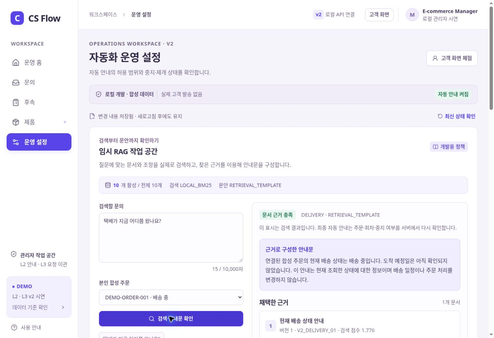

# CS Flow AI v2 · 로컬 개발 프로젝트

기획서 v4.1의 **L2 자동 안내와 L3 사람 이관**을 직접 실행하고 수정하는 독립 개발 버전입니다. 기존 v1과 팀 브랜치는 유지하며, 이 브랜치에서 화면·로컬 API·임시 RAG·합성 데이터를 함께 개발합니다.

단일 HTML 시연에서 한 단계 진행하여, React 화면이 실제 로컬 HTTP API를 호출하고 처리 결과를 SQLite에 저장합니다. 외부 API 키 없이 실행됩니다. 정식 서비스 연결 전까지 사용하는 합성 데이터 개발 환경입니다.

## 처음 실행하기

**준비: Node.js 24 LTS를 설치합니다.** Python, Docker, Azure 계정, OpenAI API 키는 기본 실행에 필요하지 않습니다.

[Node.js 공식 다운로드](https://nodejs.org/en/download)에서 **24.x LTS**를 선택하세요. [기획형 설명서 PDF](docs/CS_Flow_v2_1_guide_20261104.pdf)에도 실행과 사용 순서를 정리했습니다.

1. 이 브랜치의 ZIP을 내려받아 압축을 풉니다.
2. `package.json`이 있는 폴더를 VS Code에서 엽니다.
3. 터미널에서 다음을 실행합니다.

```bash
npm ci
npm run dev
```

4. 브라우저에서 **http://127.0.0.1:5173** 을 엽니다.

Windows에서는 `시작하기.cmd`를 실행해도 됩니다. 처음에는 의존성을 설치하므로 인터넷 연결이 필요합니다. 설치 이후 기본 문의 처리·검색·저장은 로컬에서 실행됩니다. 종료할 때 실행 창에서 `Ctrl+C`를 누릅니다.

다시 실행할 때는 `npm run dev`만 입력합니다. 문의와 후속 상태는 `.local/`의 로컬 DB에 보존됩니다. 초기 데이터로 돌아가려면 화면의 **운영 설정 → 시연 처음으로**를 사용합니다. 다른 브랜치나 기존 v1 데이터에는 영향을 주지 않습니다.

## 먼저 확인할 순서

| 화면 | 해볼 일 | 확인되는 기능 |
| --- | --- | --- |
| 운영 홈 | 합성 문의 시나리오 추가 | 자동 안내와 사람 대기열 분기 |
| 고객 화면 | 배송·반품 절차를 자신의 문장으로 질문 | 실제 문서 검색과 근거 기반 안내 |
| 문의 | 사람 이관 문의 인수 → 초안 저장 → 검토 승인 → 응답 | 승인 본문·회차·버전 확인 |
| 후속 | 담당자·기한·진행 상태 변경 | 미완료 후속과 해결 상태 구분 |
| 운영 설정 | 문서 검색 확인, 자동화 중지·검사·재개 | 근거 조회와 자동화 제어 |
| 제품 | 제품 상세의 개선 제안·이상 징후 확인 | 기존 P1/P2 분석 유지 |

질문 예: `배송 상태가 궁금해요`, `반품 신청은 어떻게 하나요?`, `문의 답변은 어디에서 확인하나요?`. 환불 승인·보상 확정·계정 권리 변경 요청은 사람 확인으로 보냅니다.

## 이번 버전의 기능

- **실제 로컬 API:** 화면의 업무 명령은 서버에서 처리합니다. 실패를 브라우저의 가짜 성공으로 대체하지 않습니다.
- **지속 저장:** 문의·대화·승인·후속·자동화 상태를 SQLite 트랜잭션으로 저장합니다. 수정 충돌과 같은 요청의 중복 처리를 검사합니다.
- **임시 RAG:** 파일로 분리한 개발용 정책을 한국어 어절·문자 조각 기반 BM25로 검색하고, 선택한 문서 조항과 합성 주문 조회값으로 안내를 구성합니다.
- **근거 표시:** 검색 결과의 제목·조항·문서 UUID·버전·본문 해시를 확인할 수 있습니다. 근거가 없거나 유효하지 않으면 자동 완료하지 않습니다.
- **L2/L3 경계:** 저위험 정보 안내만 자동 완료합니다. 환불·보상·계정 권리 결정, 사람 상담 요청, 필수 후속, 근거 부족은 사람 경로로 이동합니다.
- **기존 프런트 유지:** 운영 홈·문의·후속·제품·운영 설정 구성과 보라색 디자인을 이어갑니다. 고객 화면은 공개 대화와 공개 후속만 표시합니다.
- **P1/P2 유지:** 기존 합성 집계와 사전 작성 제안, 이상 징후 계산을 유지합니다. 현재 7일 자료에 대해 28일이 필요한 판단은 이력 부족으로 표시합니다.
- **제품 업무 연결:** 별도 합성 연결표를 통해 제품 상세에서 현재 관련 문의·후속을 조회하고 해당 업무로 이동합니다. 기존 분석 집계와 현재 문의 원장의 수치는 합산하지 않습니다.

## 임시 RAG의 범위



기본 생성 방식은 **`RETRIEVAL_TEMPLATE`**입니다. 실제로 문서를 검색하지만, OpenAI 모델이나 임베딩 API를 호출하지 않습니다. 정책에 없는 도착일·환불 금액·승인 결과를 만들어 내지 않습니다. 원본의 팀 검토 대기 정책을 승인된 운영 정책으로 바꾸지 않고, 별도 `DEMO_ONLY` 문서만 사용합니다.

현재 서버는 로컬 개발 편의를 위한 **Node.js + SQLite 참조 구현**입니다. 팀의 **FastAPI + PostgreSQL, JWT 인증, 작업 lease·worker, 외부 발송, Fabric**을 대체하거나 연동 완료했다고 의미하지 않습니다. 상세한 현재 범위는 [구현 범위](docs/IMPLEMENTATION.md), 교체 지점은 [팀 연결 안내](docs/INTEGRATION.md)를 참고하세요.

## 어디를 수정하면 되나요?

| 수정 목적 | 위치 |
| --- | --- |
| 화면·버튼·입력 폼 | `frontend/src/components/` |
| 색상·글자·배치 | `frontend/src/styles/`, 각 컴포넌트의 CSS |
| 프런트의 API 호출 규격 | `frontend/src/lib/api/` |
| HTTP 경로·역할·저장 처리 | `backend/src/` |
| 자동 안내·승인·후속 업무 규칙 | `shared/operations/` |
| 임시 RAG 검색·의도·응답 생성 | `ai/rag/` |
| RAG 정책 문서 | `data/rag/` |
| 기존 P1/P2 분석 자료 | `data/analytics/` |
| 제품과 현재 문의·후속의 합성 연결 | `data/operations/product-links.json` |
| DB 구조 | `database/` |
| 실행·검사 명령 | `scripts/` |
| 개발 설명과 연결 계약 | `docs/` |

정책 본문을 바꾼 경우 해시와 문서 버전을 함께 갱신해야 합니다. 구체적인 수정 방법은 [RAG 설명](docs/RAG.md)을 따릅니다.

## 개발 명령

```bash
npm run check       # TypeScript 검사
npm test            # 업무 규칙·검색·저장·API·기존 분석 검사
npm run rag:check   # 정책 문서 무결성 검사
npm run build       # 배포 가능한 프런트 파일 생성
npm start           # 빌드된 화면과 API를 함께 실행
```

이 프로젝트는 합성 데이터용입니다. 실제 고객명·연락처·주소·인증정보를 넣지 않습니다. 개발용 역할 전환은 실제 로그인 시스템이 아니며 기본 서버는 내 컴퓨터에서만 접근하도록 실행합니다. `.env`, DB, 실행 로그, 의존성 폴더는 Git에 저장하지 않습니다.

## 다음 연결 작업

팀 API가 확정되면 프런트 API adapter를 해당 응답에 맞추고, 임시 검색 provider를 정식 RAG로 교체합니다. 이때 문서 UUID·버전·해시, 문의 회차·버전, 사람 승인, 전역 중지 검사와 최종 저장 경계는 계속 유지해야 합니다. [팀 연결 안내](docs/INTEGRATION.md)에 현재 확인한 브랜치와 미확정 사항을 정리했습니다.
