# PostgreSQL 물리 스키마 — 구현 확인

이 문서는 기존 migration을 새 로컬 PostgreSQL 16.15에 실제 적용한 카탈로그에서 생성했다. Azure DB 재조회 결과가 아니다. [DDL](schema.sql), [기계 판독 카탈로그](schema-catalog.json), [검증](schema-verification.json)을 함께 읽는다.

## 테이블 이름과 관계

요청한 products/customers/orders/tickets/audit_events/followup_actions/teams/users는 모두 public 안의 동일 이름 물리 테이블이다. 31개 업무·보조 테이블과 alembic_version 1개다. fixture의 customer_contacts/coverage/Silver/Gold 보조 5종과 inquiries/order_items 뷰는 A migration에 없다. [fixture 차이표](fixture-differences.md)를 따른다.

아래 ERD는 전체 FK를 표시하며 주요 PK/FK/UK와 상태·회차만 보여준다. 복합 FK는 컬럼 묶음 하나이며 MATCH SIMPLE의 NULL 허용은 아래 본문을 우선한다. 부분 UNIQUE의 조건은 ERD 선만으로 표현하지 않으며 정확한 조건은 각 인덱스를 읽는다.

```mermaid
erDiagram
    ai_suggestions {
        uuid suggestion_id PK
        uuid ticket_id FK,UK
        bigint cycle_no UK
        bigint revision UK
        uuid rule_id FK
    }
    alembic_version {
        character_varying_32_ version_num PK
    }
    analytics_batches {
        uuid batch_id PK
        text status
    }
    analytics_daily {
        uuid batch_id FK,PK
        date day PK
        text team_key PK
        text category PK
    }
    analytics_product_daily {
        uuid batch_id FK,PK
        date day PK
        uuid product_id FK,PK
        text category PK
        text issue_tag PK
    }
    analytics_product_risk {
        uuid batch_id FK,PK
        text scope_key PK
        uuid product_id FK,PK
    }
    analytics_product_voc_daily {
        uuid batch_id FK,PK
        text scope_key PK
        uuid product_id FK,PK
        date day PK
        text primary_issue PK
    }
    analytics_publication {
        integer singleton_id PK
        uuid batch_id FK
    }
    analytics_receipts {
        uuid batch_id FK,PK
    }
    approvals {
        uuid approval_id PK
        uuid ticket_id FK
        uuid suggestion_id FK
        bigint cycle_no
        uuid reviewer_id FK
    }
    assignments {
        uuid assignment_id PK
        uuid ticket_id FK
        bigint cycle_no
        uuid team_id FK
        uuid agent_id FK
    }
    audit_events {
        uuid event_id PK
        uuid ticket_id FK
        bigint cycle_no
        uuid actor_user_id FK
        text event_key UK
    }
    automation_control {
        integer singleton_id PK
        bigint revision
        uuid changed_by FK
    }
    automation_control_history {
        bigint revision PK
        uuid changed_by FK
    }
    automation_jobs {
        uuid job_id PK
        uuid ticket_id FK,UK
        bigint cycle_no UK
        text status
        uuid source_message_id FK
    }
    automation_rules {
        uuid rule_id PK
        text rule_key UK
        bigint version UK
        uuid updated_by FK
    }
    customers {
        uuid customer_id PK
        uuid user_id FK,UK
        text customer_key UK
    }
    followup_actions {
        uuid action_id PK
        uuid ticket_id FK
        bigint cycle_no
        uuid product_id FK
        uuid owner_user_id FK
        uuid owner_team_id FK
        text status
        bigint version
        uuid origin_team_id FK
    }
    idempotency_keys {
        uuid user_id FK,PK
        character_varying_128_ key PK
        uuid ticket_id FK
        uuid followup_id FK
    }
    knowledge_documents {
        uuid document_id PK
        text policy_key UK
        bigint version UK
    }
    messages {
        uuid message_id PK
        uuid ticket_id FK
        bigint cycle_no
        uuid approval_id FK
    }
    orders {
        uuid order_id PK,UK
        uuid customer_id FK,UK
        uuid product_id FK,UK
        text order_number UK
        bigint version
    }
    products {
        uuid product_id PK
        text sku UK
    }
    queue_routes {
        uuid ticket_id FK,PK
        bigint cycle_no PK
        uuid team_id FK
        bigint revision
    }
    returns {
        uuid return_id PK
        uuid order_id FK,UK
        text status
    }
    shipments {
        uuid shipment_id PK
        uuid order_id FK,UK
        text status
        bigint version
    }
    staff_permissions {
        uuid user_id FK,PK
        character_varying_64_ permission PK
        uuid granted_by FK
    }
    team_categories {
        uuid team_id FK,PK
        character_varying_32_ category PK
    }
    teams {
        uuid team_id PK
    }
    tickets {
        uuid ticket_id PK
        uuid customer_id FK
        uuid order_id FK
        uuid product_id FK
        text status
        bigint version
        bigint cycle_no
        uuid team_id FK
    }
    user_team_scopes {
        uuid user_id FK,PK
        uuid team_id FK,PK
    }
    users {
        uuid user_id PK
        text login_name UK
        uuid team_id FK
    }
    automation_rules ||--o{ ai_suggestions : "rule_id"
    tickets |o--o{ ai_suggestions : "ticket_id"
    analytics_batches ||--o{ analytics_daily : "batch_id"
    analytics_batches ||--o{ analytics_product_daily : "batch_id"
    products ||--o{ analytics_product_daily : "product_id"
    analytics_batches ||--o{ analytics_product_risk : "batch_id"
    products ||--o{ analytics_product_risk : "product_id"
    analytics_batches ||--o{ analytics_product_voc_daily : "batch_id"
    products ||--o{ analytics_product_voc_daily : "product_id"
    analytics_receipts |o--o{ analytics_publication : "batch_id"
    analytics_batches ||--o| analytics_receipts : "batch_id"
    users |o--o{ approvals : "reviewer_id"
    ai_suggestions ||--o{ approvals : "suggestion_id"
    tickets |o--o{ approvals : "ticket_id"
    users |o--o{ assignments : "agent_id"
    teams |o--o{ assignments : "team_id"
    tickets ||--o{ assignments : "ticket_id"
    users |o--o{ audit_events : "actor_user_id"
    tickets |o--o{ audit_events : "ticket_id"
    users |o--o{ automation_control : "changed_by"
    users |o--o{ automation_control_history : "changed_by"
    messages |o--o{ automation_jobs : "source_message_id"
    tickets ||--o{ automation_jobs : "ticket_id"
    users |o--o{ automation_rules : "updated_by"
    users ||--o| customers : "user_id"
    teams ||--o{ followup_actions : "origin_team_id"
    teams ||--o{ followup_actions : "owner_team_id"
    users |o--o{ followup_actions : "owner_user_id"
    products |o--o{ followup_actions : "product_id"
    tickets |o--o{ followup_actions : "ticket_id"
    followup_actions |o--o{ idempotency_keys : "followup_id"
    tickets |o--o{ idempotency_keys : "ticket_id"
    users ||--o{ idempotency_keys : "user_id"
    approvals |o--o{ messages : "approval_id"
    tickets ||--o{ messages : "ticket_id"
    customers ||--o{ orders : "customer_id"
    products |o--o{ orders : "product_id"
    teams |o--o{ queue_routes : "team_id"
    tickets ||--o{ queue_routes : "ticket_id"
    orders |o--o| returns : "order_id"
    orders |o--o| shipments : "order_id"
    users |o--o{ staff_permissions : "granted_by"
    users ||--o{ staff_permissions : "user_id"
    teams ||--o{ team_categories : "team_id"
    customers ||--o{ tickets : "customer_id"
    orders |o--o{ tickets : "order_id,customer_id,product_id"
    products |o--o{ tickets : "product_id"
    teams |o--o{ tickets : "team_id"
    teams ||--o{ user_team_scopes : "team_id"
    users ||--o{ user_team_scopes : "user_id"
    teams |o--o{ users : "team_id"
```



## 고객·주문·상품·티켓의 NULL과 연결

- customers.user_id는 NOT NULL + UNIQUE FK이므로 한 프로필은 한 사용자에 연결된다. DB는 사용자의 CUSTOMER 역할까지 FK로 검사하지 않으며 서비스가 확인한다.
- orders.customer_id는 필수, product_id는 NULL 허용이다. 단일 제품 주문 구조이며 order_items 테이블은 없다.
- tickets.customer_id는 필수, order_id/product_id/team_id는 NULL 허용이다. order_id가 있으면 product_id가 있어야 한다. (order_id,customer_id,product_id) 복합 FK가 orders의 같은 묶음을 참조하므로 주문·고객·상품 일치를 DB가 검사한다. order_id=NULL인 일반 문의는 product_id=NULL도 가능하다. product_id만 있으면 상품 FK는 적용되지만 주문 복합 FK는 MATCH SIMPLE로 건너뛴다.
- team_id=NULL은 미귀속이며 전사 공개를 뜻하지 않는다. queue_routes와 배정은 별도 테이블이고 category만으로 귀속을 추정하지 않는다.
- followup_actions는 ticket_id/product_id 중 정확히 하나다. 티켓 후속은 원래/책임 cycle 필수, 상품 후속은 두 cycle NULL이며 해결 blocker가 될 수 없다.

## 시각·타입·기본값

**구현 확인:** 모든 timestamp 컬럼은 timestamp with time zone(timestamptz)이다. app/db.py의 UTCDateTime은 naive 입력을 거부하고 aware 값을 UTC로 변환한다. API의 AwareDatetime 입력과 분석 모델도 UTC로 정규화한다. DB 연결은 timezone=UTC다. timestamptz는 원래 KST offset/지역명을 저장하는 타입이 아니므로 화면만 Asia/Seoul로 변환한다. 응답은 ISO8601 UTC(Z 또는 +00:00), date는 분석의 KST 달력 일자다. UTC 2026-10-30T15:00:00Z = KST 2026-10-31 00:00:00+09:00이고 분석 day 범위는 [start,end)다. [PostgreSQL 시각](https://www.postgresql.org/docs/16/datatype-datetime.html).

**구현 확인:** DB DEFAULT와 SQLAlchemy client default는 별개다. 아래 `없음`은 raw SQL INSERT 때 자동 생성되지 않는다는 뜻이다. 대부분 UUID/created_at/updated_at/version/status/data_origin은 A Python이 채우며 DB 자동 updated_at trigger는 없다. PK UUID의 gen_random_uuid() 기본값도 없다. Export가 원본 UUID를 자체 생성하거나 default를 추측하면 안 된다.

**구현 확인:** PostgreSQL native ENUM 타입은 0개다. 상태는 text/varchar + CHECK 또는 API Literal이다. CHECK가 없는 category/priority/order_status/payment_status/kind 등은 DB Enum으로 확정하지 않는다. API Category/Issue 제한은 분석 입력 모델에만 별도로 존재한다.

## 전체 컬럼·제약·인덱스

### products

| 컬럼 | PostgreSQL 정확한 타입 | NULL 허용 | DB DEFAULT | A client default | 키 |
|---|---|---|---|---|---|
| `product_id` | `uuid` | NO | 없음 | 없음 | PK |
| `sku` | `text` | NO | 없음 | 없음 | UK |
| `name` | `text` | NO | 없음 | 없음 |  |
| `category` | `text` | NO | 없음 | 없음 |  |
| `active` | `boolean` | NO | 없음 | 없음 |  |
| `created_at` | `timestamp with time zone` | NO | 없음 | utcnow() |  |
| `updated_at` | `timestamp with time zone` | NO | 없음 | utcnow() |  |
| `data_origin` | `text` | NO | 없음 | 'APPLICATION' |  |
| `scenario_id` | `text` | NO | 없음 | 'LIVE' |  |
| `generator_version` | `text` | NO | 없음 | 'backend-a-v1' |  |
| `seed` | `bigint` | NO | 없음 | 0 |  |

PK:

- `pk_products`: `PRIMARY KEY (product_id)`

UNIQUE:

- `uq_products_sku`: `UNIQUE (sku)`

인덱스(제약 backing index 포함):

- `CREATE UNIQUE INDEX pk_products ON public.products USING btree (product_id)`
- `CREATE UNIQUE INDEX uq_products_sku ON public.products USING btree (sku)`

### customers

| 컬럼 | PostgreSQL 정확한 타입 | NULL 허용 | DB DEFAULT | A client default | 키 |
|---|---|---|---|---|---|
| `customer_id` | `uuid` | NO | 없음 | 없음 | PK |
| `user_id` | `uuid` | NO | 없음 | 없음 | FK,UK |
| `display_name` | `text` | NO | 없음 | 없음 |  |
| `verification_status` | `text` | NO | 없음 | 없음 |  |
| `profile_masked` | `jsonb` | YES | 없음 | 없음 |  |
| `deleted_at` | `timestamp with time zone` | YES | 없음 | 없음 |  |
| `customer_key` | `text` | NO | 없음 | 없음 | UK |
| `created_at` | `timestamp with time zone` | NO | 없음 | utcnow() |  |
| `updated_at` | `timestamp with time zone` | NO | 없음 | utcnow() |  |
| `data_origin` | `text` | NO | 없음 | 'APPLICATION' |  |
| `scenario_id` | `text` | NO | 없음 | 'LIVE' |  |
| `generator_version` | `text` | NO | 없음 | 'backend-a-v1' |  |
| `seed` | `bigint` | NO | 없음 | 0 |  |

PK:

- `pk_customers`: `PRIMARY KEY (customer_id)`

FK:

- `fk_customers_user_id_users`: `FOREIGN KEY (user_id) REFERENCES users(user_id)`

UNIQUE:

- `uq_customers_customer_key`: `UNIQUE (customer_key)`
- `uq_customers_user_id`: `UNIQUE (user_id)`

인덱스(제약 backing index 포함):

- `CREATE UNIQUE INDEX pk_customers ON public.customers USING btree (customer_id)`
- `CREATE UNIQUE INDEX uq_customers_customer_key ON public.customers USING btree (customer_key)`
- `CREATE UNIQUE INDEX uq_customers_user_id ON public.customers USING btree (user_id)`

### orders

| 컬럼 | PostgreSQL 정확한 타입 | NULL 허용 | DB DEFAULT | A client default | 키 |
|---|---|---|---|---|---|
| `order_id` | `uuid` | NO | 없음 | 없음 | PK,UK |
| `customer_id` | `uuid` | NO | 없음 | 없음 | FK,UK |
| `product_id` | `uuid` | YES | 없음 | 없음 | FK,UK |
| `quantity` | `bigint` | NO | 없음 | 없음 |  |
| `order_number` | `text` | NO | 없음 | 없음 | UK |
| `order_status` | `text` | NO | 없음 | 없음 |  |
| `payment_status` | `text` | NO | 없음 | 없음 |  |
| `amount` | `numeric(12,2)` | NO | 없음 | 없음 |  |
| `placed_at` | `timestamp with time zone` | NO | 없음 | 없음 |  |
| `paid_at` | `timestamp with time zone` | YES | 없음 | 없음 |  |
| `version` | `bigint` | NO | 없음 | 없음 |  |
| `created_at` | `timestamp with time zone` | NO | 없음 | utcnow() |  |
| `updated_at` | `timestamp with time zone` | NO | 없음 | utcnow() |  |
| `data_origin` | `text` | NO | 없음 | 'APPLICATION' |  |
| `scenario_id` | `text` | NO | 없음 | 'LIVE' |  |
| `generator_version` | `text` | NO | 없음 | 'backend-a-v1' |  |
| `seed` | `bigint` | NO | 없음 | 0 |  |

PK:

- `pk_orders`: `PRIMARY KEY (order_id)`

FK:

- `fk_orders_customer_id_customers`: `FOREIGN KEY (customer_id) REFERENCES customers(customer_id)`
- `fk_orders_product_id_products`: `FOREIGN KEY (product_id) REFERENCES products(product_id)`

UNIQUE:

- `uq_orders_order_id_customer_id_product_id`: `UNIQUE (order_id, customer_id, product_id)`
- `uq_orders_order_number`: `UNIQUE (order_number)`

CHECK:

- `ck_orders_quantity_amount`: `CHECK (quantity > 0 AND amount >= 0::numeric AND version >= 1)`

인덱스(제약 backing index 포함):

- `CREATE INDEX ix_orders_customer_page ON public.orders USING btree (customer_id, placed_at, order_id)`
- `CREATE UNIQUE INDEX pk_orders ON public.orders USING btree (order_id)`
- `CREATE UNIQUE INDEX uq_orders_order_id_customer_id_product_id ON public.orders USING btree (order_id, customer_id, product_id)`
- `CREATE UNIQUE INDEX uq_orders_order_number ON public.orders USING btree (order_number)`

### tickets

| 컬럼 | PostgreSQL 정확한 타입 | NULL 허용 | DB DEFAULT | A client default | 키 |
|---|---|---|---|---|---|
| `ticket_id` | `uuid` | NO | 없음 | 없음 | PK |
| `customer_id` | `uuid` | NO | 없음 | 없음 | FK |
| `order_id` | `uuid` | YES | 없음 | 없음 | FK |
| `product_id` | `uuid` | YES | 없음 | 없음 | FK |
| `category` | `text` | NO | 없음 | 'UNCLASSIFIED' |  |
| `priority` | `text` | NO | 없음 | 'NORMAL' |  |
| `status` | `text` | NO | 없음 | 'OPEN' |  |
| `version` | `bigint` | NO | 없음 | 1 |  |
| `cycle_no` | `bigint` | NO | 없음 | 1 |  |
| `requested_mode` | `text` | NO | 없음 | 'AUTO' |  |
| `resolution_mode` | `text` | YES | 없음 | 없음 |  |
| `issue_tags` | `jsonb` | NO | 없음 | list() |  |
| `sla_due_at` | `timestamp with time zone` | NO | 없음 | 없음 |  |
| `first_replied_at` | `timestamp with time zone` | YES | 없음 | 없음 |  |
| `resolved_at` | `timestamp with time zone` | YES | 없음 | 없음 |  |
| `last_error_code` | `text` | YES | 없음 | 없음 |  |
| `is_complaint` | `boolean` | NO | 없음 | False |  |
| `primary_issue` | `text` | YES | 없음 | 없음 |  |
| `complaint_first_at` | `timestamp with time zone` | YES | 없음 | 없음 |  |
| `voc_label_version` | `text` | YES | 없음 | 없음 |  |
| `voc_label_source` | `text` | YES | 없음 | 없음 |  |
| `label_status` | `text` | NO | 없음 | 'UNLABELED' |  |
| `human_verified` | `boolean` | NO | 없음 | False |  |
| `created_at` | `timestamp with time zone` | NO | 없음 | utcnow() |  |
| `updated_at` | `timestamp with time zone` | NO | 없음 | utcnow() |  |
| `data_origin` | `text` | NO | 없음 | 'APPLICATION' |  |
| `scenario_id` | `text` | NO | 없음 | 'LIVE' |  |
| `generator_version` | `text` | NO | 없음 | 'backend-a-v1' |  |
| `seed` | `bigint` | NO | 없음 | 0 |  |
| `team_id` | `uuid` | YES | 없음 | 없음 | FK |

PK:

- `pk_tickets`: `PRIMARY KEY (ticket_id)`

FK:

- `fk_tickets_customer_id_customers`: `FOREIGN KEY (customer_id) REFERENCES customers(customer_id)`
- `fk_tickets_owned_order_product`: `FOREIGN KEY (order_id, customer_id, product_id) REFERENCES orders(order_id, customer_id, product_id)`
- `fk_tickets_product_id_products`: `FOREIGN KEY (product_id) REFERENCES products(product_id)`
- `fk_tickets_team_id_teams`: `FOREIGN KEY (team_id) REFERENCES teams(team_id)`

CHECK:

- `ck_tickets_order_product`: `CHECK (order_id IS NULL OR product_id IS NOT NULL)`
- `ck_tickets_requested_mode`: `CHECK (requested_mode = ANY (ARRAY['AUTO'::text, 'HUMAN'::text]))`
- `ck_tickets_resolution_mode`: `CHECK (resolution_mode IS NULL OR (resolution_mode = ANY (ARRAY['AUTO'::text, 'HUMAN'::text])))`
- `ck_tickets_resolved_at`: `CHECK (status <> 'RESOLVED'::text OR resolved_at IS NOT NULL AND resolution_mode IS NOT NULL)`
- `ck_tickets_status`: `CHECK (status = ANY (ARRAY['OPEN'::text, 'PROCESSING'::text, 'WAITING_CUSTOMER'::text, 'HANDOFF_PENDING'::text, 'ASSIGNED'::text, 'IN_PROGRESS'::text, 'FOLLOWUP_PENDING'::text, 'RESOLVED'::text, 'CANCELLED'::text]))`
- `ck_tickets_version_cycle`: `CHECK (version >= 1 AND cycle_no >= 1)`

인덱스(제약 backing index 포함):

- `CREATE INDEX ix_tickets_customer_page ON public.tickets USING btree (customer_id, created_at, ticket_id)`
- `CREATE INDEX ix_tickets_team ON public.tickets USING btree (team_id, created_at, ticket_id)`
- `CREATE UNIQUE INDEX pk_tickets ON public.tickets USING btree (ticket_id)`

### audit_events

| 컬럼 | PostgreSQL 정확한 타입 | NULL 허용 | DB DEFAULT | A client default | 키 |
|---|---|---|---|---|---|
| `event_id` | `uuid` | NO | 없음 | 없음 | PK |
| `ticket_id` | `uuid` | YES | 없음 | 없음 | FK |
| `cycle_no` | `bigint` | YES | 없음 | 없음 |  |
| `actor_user_id` | `uuid` | YES | 없음 | 없음 | FK |
| `actor_service` | `text` | YES | 없음 | 없음 |  |
| `action` | `text` | NO | 없음 | 없음 |  |
| `target_type` | `text` | NO | 없음 | 없음 |  |
| `target_id` | `uuid` | YES | 없음 | 없음 |  |
| `event_key` | `text` | NO | 없음 | 없음 | UK |
| `payload` | `jsonb` | NO | 없음 | dict() |  |
| `created_at` | `timestamp with time zone` | NO | 없음 | utcnow() |  |
| `data_origin` | `text` | NO | 없음 | 'APPLICATION' |  |
| `scenario_id` | `text` | NO | 없음 | 'LIVE' |  |
| `generator_version` | `text` | NO | 없음 | 'backend-a-v1' |  |
| `seed` | `bigint` | NO | 없음 | 0 |  |
| `result` | `character varying(16)` | NO | 'SUCCESS'::character varying | 없음 |  |
| `reason_code` | `character varying(64)` | NO | 'FIXTURE_HISTORY'::character varying | 없음 |  |

PK:

- `pk_audit_events`: `PRIMARY KEY (event_id)`

FK:

- `fk_audit_events_actor_user_id_users`: `FOREIGN KEY (actor_user_id) REFERENCES users(user_id)`
- `fk_audit_events_ticket_id_tickets`: `FOREIGN KEY (ticket_id) REFERENCES tickets(ticket_id)`

UNIQUE:

- `uq_audit_events_event_key`: `UNIQUE (event_key)`

CHECK:

- `ck_audit_events_result`: `CHECK (result::text = ANY (ARRAY['SUCCESS'::character varying, 'DENIED'::character varying, 'FAILURE'::character varying]::text[]))`

인덱스(제약 backing index 포함):

- `CREATE UNIQUE INDEX pk_audit_events ON public.audit_events USING btree (event_id)`
- `CREATE UNIQUE INDEX uq_audit_events_event_key ON public.audit_events USING btree (event_key)`

### followup_actions

| 컬럼 | PostgreSQL 정확한 타입 | NULL 허용 | DB DEFAULT | A client default | 키 |
|---|---|---|---|---|---|
| `action_id` | `uuid` | NO | 없음 | 없음 | PK |
| `ticket_id` | `uuid` | YES | 없음 | 없음 | FK |
| `cycle_no` | `bigint` | YES | 없음 | 없음 |  |
| `product_id` | `uuid` | YES | 없음 | 없음 | FK |
| `owner_user_id` | `uuid` | YES | 없음 | 없음 | FK |
| `owner_team_id` | `uuid` | NO | 없음 | 없음 | FK |
| `kind` | `text` | NO | 없음 | 없음 |  |
| `status` | `text` | NO | 없음 | 없음 |  |
| `public_note` | `text` | YES | 없음 | 없음 |  |
| `internal_note` | `text` | YES | 없음 | 없음 |  |
| `blocks_resolution` | `boolean` | NO | 없음 | 없음 |  |
| `due_at` | `timestamp with time zone` | YES | 없음 | 없음 |  |
| `completed_at` | `timestamp with time zone` | YES | 없음 | 없음 |  |
| `version` | `bigint` | NO | 없음 | 없음 |  |
| `created_at` | `timestamp with time zone` | NO | 없음 | utcnow() |  |
| `updated_at` | `timestamp with time zone` | NO | 없음 | utcnow() |  |
| `data_origin` | `text` | NO | 없음 | 'APPLICATION' |  |
| `scenario_id` | `text` | NO | 없음 | 'LIVE' |  |
| `generator_version` | `text` | NO | 없음 | 'backend-a-v1' |  |
| `seed` | `bigint` | NO | 없음 | 0 |  |
| `origin_team_id` | `uuid` | NO | 없음 | <lambda>() | FK |
| `responsibility_cycle_no` | `bigint` | YES | 없음 | <lambda>() |  |
| `cancelled_at` | `timestamp with time zone` | YES | 없음 | 없음 |  |
| `cancellation_reason` | `character varying(64)` | YES | 없음 | 없음 |  |

PK:

- `pk_followup_actions`: `PRIMARY KEY (action_id)`

FK:

- `fk_followup_actions_origin_team_id_teams`: `FOREIGN KEY (origin_team_id) REFERENCES teams(team_id)`
- `fk_followup_actions_owner_team_id_teams`: `FOREIGN KEY (owner_team_id) REFERENCES teams(team_id)`
- `fk_followup_actions_owner_user_id_users`: `FOREIGN KEY (owner_user_id) REFERENCES users(user_id)`
- `fk_followup_actions_product_id_products`: `FOREIGN KEY (product_id) REFERENCES products(product_id)`
- `fk_followup_actions_ticket_id_tickets`: `FOREIGN KEY (ticket_id) REFERENCES tickets(ticket_id)`

CHECK:

- `ck_followup_actions_cancelled`: `CHECK (status = 'CANCELLED'::text AND cancelled_at IS NOT NULL AND cancellation_reason IS NOT NULL AND (cancellation_reason::text = ANY (ARRAY['CUSTOMER_WITHDREW'::character varying, 'NO_LONGER_NEEDED'::character varying, 'DUPLICATE'::character varying, 'OTHER'::character varying]::text[])) OR status <> 'CANCELLED'::text AND cancelled_at IS NULL AND cancellation_reason IS NULL)`
- `ck_followup_actions_completed`: `CHECK (status = 'DONE'::text AND completed_at IS NOT NULL OR status <> 'DONE'::text AND completed_at IS NULL)`
- `ck_followup_actions_cycle`: `CHECK (ticket_id IS NOT NULL AND cycle_no IS NOT NULL AND cycle_no >= 1 AND responsibility_cycle_no IS NOT NULL AND responsibility_cycle_no >= cycle_no OR product_id IS NOT NULL AND cycle_no IS NULL AND responsibility_cycle_no IS NULL)`
- `ck_followup_actions_due`: `CHECK (due_at IS NULL OR due_at >= created_at)`
- `ck_followup_actions_notes`: `CHECK ((public_note IS NULL OR length(public_note) <= 4000) AND (internal_note IS NULL OR length(internal_note) <= 10000))`
- `ck_followup_actions_product_block`: `CHECK (product_id IS NULL OR NOT blocks_resolution)`
- `ck_followup_actions_state`: `CHECK (status = ANY (ARRAY['OPEN'::text, 'IN_PROGRESS'::text, 'DONE'::text, 'CANCELLED'::text]))`
- `ck_followup_actions_target`: `CHECK (ticket_id IS NULL AND product_id IS NOT NULL OR ticket_id IS NOT NULL AND product_id IS NULL)`
- `ck_followup_actions_version`: `CHECK (version >= 1)`

인덱스(제약 backing index 포함):

- `CREATE INDEX ix_followups_team_page ON public.followup_actions USING btree (owner_team_id, created_at, action_id)`
- `CREATE INDEX ix_followups_ticket ON public.followup_actions USING btree (ticket_id, status, blocks_resolution)`
- `CREATE UNIQUE INDEX pk_followup_actions ON public.followup_actions USING btree (action_id)`

### teams

| 컬럼 | PostgreSQL 정확한 타입 | NULL 허용 | DB DEFAULT | A client default | 키 |
|---|---|---|---|---|---|
| `team_id` | `uuid` | NO | 없음 | 없음 | PK |
| `name` | `text` | NO | 없음 | 없음 |  |
| `supported_categories` | `jsonb` | NO | 없음 | 없음 |  |
| `active` | `boolean` | NO | 없음 | 없음 |  |
| `created_at` | `timestamp with time zone` | NO | 없음 | utcnow() |  |
| `updated_at` | `timestamp with time zone` | NO | 없음 | utcnow() |  |
| `data_origin` | `text` | NO | 없음 | 'APPLICATION' |  |
| `scenario_id` | `text` | NO | 없음 | 'LIVE' |  |
| `generator_version` | `text` | NO | 없음 | 'backend-a-v1' |  |
| `seed` | `bigint` | NO | 없음 | 0 |  |

PK:

- `pk_teams`: `PRIMARY KEY (team_id)`

인덱스(제약 backing index 포함):

- `CREATE UNIQUE INDEX pk_teams ON public.teams USING btree (team_id)`

### users

| 컬럼 | PostgreSQL 정확한 타입 | NULL 허용 | DB DEFAULT | A client default | 키 |
|---|---|---|---|---|---|
| `user_id` | `uuid` | NO | 없음 | 없음 | PK |
| `login_name` | `text` | NO | 없음 | 없음 | UK |
| `password_hash` | `text` | NO | 없음 | 없음 |  |
| `role` | `text` | NO | 없음 | 없음 |  |
| `team_id` | `uuid` | YES | 없음 | 없음 | FK |
| `allowed_team_ids` | `jsonb` | NO | 없음 | 없음 |  |
| `active` | `boolean` | NO | 없음 | 없음 |  |
| `created_at` | `timestamp with time zone` | NO | 없음 | utcnow() |  |
| `updated_at` | `timestamp with time zone` | NO | 없음 | utcnow() |  |
| `data_origin` | `text` | NO | 없음 | 'APPLICATION' |  |
| `scenario_id` | `text` | NO | 없음 | 'LIVE' |  |
| `generator_version` | `text` | NO | 없음 | 'backend-a-v1' |  |
| `seed` | `bigint` | NO | 없음 | 0 |  |
| `is_dev_account` | `boolean` | NO | false | 없음 |  |

PK:

- `pk_users`: `PRIMARY KEY (user_id)`

FK:

- `fk_users_team_id_teams`: `FOREIGN KEY (team_id) REFERENCES teams(team_id)`

UNIQUE:

- `uq_users_login_name`: `UNIQUE (login_name)`

CHECK:

- `ck_users_role`: `CHECK (role = ANY (ARRAY['CUSTOMER'::text, 'AGENT'::text, 'ADMIN'::text]))`

인덱스(제약 backing index 포함):

- `CREATE UNIQUE INDEX pk_users ON public.users USING btree (user_id)`
- `CREATE UNIQUE INDEX uq_users_login_name ON public.users USING btree (login_name)`

### ai_suggestions

| 컬럼 | PostgreSQL 정확한 타입 | NULL 허용 | DB DEFAULT | A client default | 키 |
|---|---|---|---|---|---|
| `suggestion_id` | `uuid` | NO | 없음 | 없음 | PK |
| `ticket_id` | `uuid` | YES | 없음 | 없음 | FK,UK |
| `cycle_no` | `bigint` | YES | 없음 | 없음 | UK |
| `revision` | `bigint` | NO | 없음 | 없음 | UK |
| `category` | `text` | NO | 없음 | 없음 |  |
| `draft` | `text` | NO | 없음 | 없음 |  |
| `confidence` | `numeric(4,3)` | YES | 없음 | 없음 |  |
| `evidence_refs` | `jsonb` | YES | 없음 | 없음 |  |
| `order_snapshot` | `jsonb` | YES | 없음 | 없음 |  |
| `gate_results` | `jsonb` | YES | 없음 | 없음 |  |
| `rule_id` | `uuid` | NO | 없음 | 없음 | FK |
| `rule_version` | `bigint` | NO | 없음 | 없음 |  |
| `template_key` | `text` | NO | 없음 | 없음 |  |
| `prompt_version` | `text` | NO | 없음 | 없음 |  |
| `model_version` | `text` | NO | 없음 | 없음 |  |
| `content_hash` | `text` | NO | 없음 | 없음 |  |
| `created_at` | `timestamp with time zone` | NO | 없음 | utcnow() |  |
| `updated_at` | `timestamp with time zone` | NO | 없음 | utcnow() |  |
| `data_origin` | `text` | NO | 없음 | 'APPLICATION' |  |
| `scenario_id` | `text` | NO | 없음 | 'LIVE' |  |
| `generator_version` | `text` | NO | 없음 | 'backend-a-v1' |  |
| `seed` | `bigint` | NO | 없음 | 0 |  |

PK:

- `pk_ai_suggestions`: `PRIMARY KEY (suggestion_id)`

FK:

- `fk_ai_suggestions_rule_id_automation_rules`: `FOREIGN KEY (rule_id) REFERENCES automation_rules(rule_id)`
- `fk_ai_suggestions_ticket_id_tickets`: `FOREIGN KEY (ticket_id) REFERENCES tickets(ticket_id)`

UNIQUE:

- `uq_ai_suggestions_ticket_id_cycle_no_revision`: `UNIQUE (ticket_id, cycle_no, revision)`

인덱스(제약 backing index 포함):

- `CREATE UNIQUE INDEX pk_ai_suggestions ON public.ai_suggestions USING btree (suggestion_id)`
- `CREATE UNIQUE INDEX uq_ai_suggestions_ticket_id_cycle_no_revision ON public.ai_suggestions USING btree (ticket_id, cycle_no, revision)`

### alembic_version

| 컬럼 | PostgreSQL 정확한 타입 | NULL 허용 | DB DEFAULT | A client default | 키 |
|---|---|---|---|---|---|
| `version_num` | `character varying(32)` | NO | 없음 | 없음 | PK |

PK:

- `alembic_version_pkc`: `PRIMARY KEY (version_num)`

인덱스(제약 backing index 포함):

- `CREATE UNIQUE INDEX alembic_version_pkc ON public.alembic_version USING btree (version_num)`

### analytics_batches

| 컬럼 | PostgreSQL 정확한 타입 | NULL 허용 | DB DEFAULT | A client default | 키 |
|---|---|---|---|---|---|
| `batch_id` | `uuid` | NO | 없음 | 없음 | PK |
| `status` | `text` | NO | 없음 | 없음 |  |
| `source_as_of` | `timestamp with time zone` | YES | 없음 | 없음 |  |
| `published_at` | `timestamp with time zone` | YES | 없음 | 없음 |  |
| `row_counts` | `jsonb` | NO | 없음 | 없음 |  |
| `checksums` | `jsonb` | NO | 없음 | 없음 |  |
| `schema_version` | `text` | NO | 없음 | 없음 |  |
| `is_current` | `boolean` | NO | 없음 | 없음 |  |
| `manifest` | `jsonb` | NO | 없음 | 없음 |  |
| `data_origin` | `text` | NO | 없음 | 'APPLICATION' |  |
| `created_at` | `timestamp with time zone` | NO | 없음 | utcnow() |  |
| `updated_at` | `timestamp with time zone` | NO | 없음 | utcnow() |  |
| `validation_passed` | `boolean` | NO | false | 없음 |  |
| `validated_at` | `timestamp with time zone` | YES | 없음 | 없음 |  |
| `content_hash` | `character varying(64)` | YES | 없음 | 없음 |  |

PK:

- `pk_analytics_batches`: `PRIMARY KEY (batch_id)`

CHECK:

- `ck_analytics_batches_current_success`: `CHECK (NOT is_current OR status = 'SUCCEEDED'::text AND published_at IS NOT NULL AND validation_passed AND validated_at IS NOT NULL AND content_hash IS NOT NULL)`

인덱스(제약 backing index 포함):

- `CREATE UNIQUE INDEX pk_analytics_batches ON public.analytics_batches USING btree (batch_id)`
- `CREATE UNIQUE INDEX uq_analytics_current ON public.analytics_batches USING btree (is_current) WHERE is_current`

트리거: `CREATE TRIGGER immutable_published BEFORE DELETE OR UPDATE ON analytics_batches FOR EACH ROW EXECUTE FUNCTION csflow_analytics_head_immutable()`

### analytics_daily

| 컬럼 | PostgreSQL 정확한 타입 | NULL 허용 | DB DEFAULT | A client default | 키 |
|---|---|---|---|---|---|
| `batch_id` | `uuid` | NO | 없음 | 없음 | FK,PK |
| `day` | `date` | NO | 없음 | 없음 | PK |
| `team_key` | `text` | NO | 없음 | 없음 | PK |
| `category` | `text` | NO | 없음 | 없음 | PK |
| `ticket_count` | `bigint` | NO | 없음 | 없음 |  |
| `auto_closed_count` | `bigint` | NO | 없음 | 없음 |  |
| `handoff_count` | `bigint` | NO | 없음 | 없음 |  |
| `reopened_count` | `bigint` | NO | 없음 | 없음 |  |
| `sla_breach_count` | `bigint` | NO | 없음 | 없음 |  |
| `duration_sum_seconds` | `double precision` | NO | 없음 | 없음 |  |
| `duration_n` | `bigint` | NO | 없음 | 없음 |  |
| `approval_count` | `bigint` | NO | 없음 | 없음 |  |
| `review_count` | `bigint` | NO | 없음 | 없음 |  |
| `data_origin` | `text` | NO | 없음 | 'APPLICATION' |  |
| `created_at` | `timestamp with time zone` | NO | 없음 | utcnow() |  |
| `updated_at` | `timestamp with time zone` | NO | 없음 | utcnow() |  |

PK:

- `pk_analytics_daily`: `PRIMARY KEY (batch_id, day, team_key, category)`

FK:

- `fk_analytics_daily_batch_id_analytics_batches`: `FOREIGN KEY (batch_id) REFERENCES analytics_batches(batch_id)`

인덱스(제약 backing index 포함):

- `CREATE UNIQUE INDEX pk_analytics_daily ON public.analytics_daily USING btree (batch_id, day, team_key, category)`

트리거: `CREATE TRIGGER immutable_published BEFORE INSERT OR DELETE OR UPDATE ON analytics_daily FOR EACH ROW EXECUTE FUNCTION csflow_analytics_mart_immutable()`

### analytics_product_daily

| 컬럼 | PostgreSQL 정확한 타입 | NULL 허용 | DB DEFAULT | A client default | 키 |
|---|---|---|---|---|---|
| `batch_id` | `uuid` | NO | 없음 | 없음 | FK,PK |
| `day` | `date` | NO | 없음 | 없음 | PK |
| `product_id` | `uuid` | NO | 없음 | 없음 | FK,PK |
| `category` | `text` | NO | 없음 | 없음 | PK |
| `issue_tag` | `text` | NO | 없음 | 없음 | PK |
| `ticket_count` | `bigint` | NO | 없음 | 없음 |  |
| `return_refund_count` | `bigint` | NO | 없음 | 없음 |  |
| `auto_count` | `bigint` | NO | 없음 | 없음 |  |
| `handoff_count` | `bigint` | NO | 없음 | 없음 |  |
| `paid_order_count` | `bigint` | YES | 없음 | 없음 |  |
| `inquiry_order_count` | `bigint` | YES | 없음 | 없음 |  |
| `prior_count` | `bigint` | YES | 없음 | 없음 |  |
| `data_origin` | `text` | NO | 없음 | 'APPLICATION' |  |
| `created_at` | `timestamp with time zone` | NO | 없음 | utcnow() |  |
| `updated_at` | `timestamp with time zone` | NO | 없음 | utcnow() |  |

PK:

- `pk_analytics_product_daily`: `PRIMARY KEY (batch_id, day, product_id, category, issue_tag)`

FK:

- `fk_analytics_product_daily_batch_id_analytics_batches`: `FOREIGN KEY (batch_id) REFERENCES analytics_batches(batch_id)`
- `fk_analytics_product_daily_product_id_products`: `FOREIGN KEY (product_id) REFERENCES products(product_id)`

인덱스(제약 backing index 포함):

- `CREATE UNIQUE INDEX pk_analytics_product_daily ON public.analytics_product_daily USING btree (batch_id, day, product_id, category, issue_tag)`

트리거: `CREATE TRIGGER immutable_published BEFORE INSERT OR DELETE OR UPDATE ON analytics_product_daily FOR EACH ROW EXECUTE FUNCTION csflow_analytics_mart_immutable()`

### analytics_product_risk

| 컬럼 | PostgreSQL 정확한 타입 | NULL 허용 | DB DEFAULT | A client default | 키 |
|---|---|---|---|---|---|
| `batch_id` | `uuid` | NO | 없음 | 없음 | FK,PK |
| `scope_key` | `text` | NO | 없음 | 없음 | PK |
| `product_id` | `uuid` | NO | 없음 | 없음 | FK,PK |
| `rule_version` | `text` | NO | 없음 | 없음 |  |
| `data_status` | `text` | NO | 없음 | 없음 |  |
| `score` | `numeric(12,6)` | YES | 없음 | 없음 |  |
| `rank` | `bigint` | YES | 없음 | 없음 |  |
| `risk_band` | `text` | YES | 없음 | 없음 |  |
| `metrics` | `jsonb` | NO | 없음 | 없음 |  |
| `components` | `jsonb` | NO | 없음 | 없음 |  |
| `source_as_of` | `timestamp with time zone` | YES | 없음 | 없음 |  |
| `window_end` | `timestamp with time zone` | NO | 없음 | 없음 |  |
| `data_origin` | `text` | NO | 없음 | 'APPLICATION' |  |
| `created_at` | `timestamp with time zone` | NO | 없음 | utcnow() |  |
| `updated_at` | `timestamp with time zone` | NO | 없음 | utcnow() |  |

PK:

- `pk_analytics_product_risk`: `PRIMARY KEY (batch_id, scope_key, product_id)`

FK:

- `fk_analytics_product_risk_batch_id_analytics_batches`: `FOREIGN KEY (batch_id) REFERENCES analytics_batches(batch_id)`
- `fk_analytics_product_risk_product_id_products`: `FOREIGN KEY (product_id) REFERENCES products(product_id)`

CHECK:

- `ck_analytics_product_risk_eligible_values`: `CHECK (data_status = 'ELIGIBLE'::text AND score IS NOT NULL AND rank IS NOT NULL AND risk_band IS NOT NULL AND score >= 0::numeric AND score <= 100::numeric AND rank > 0 AND (risk_band = ANY (ARRAY['NORMAL'::text, 'WATCH'::text, 'HIGH'::text])) OR (data_status = ANY (ARRAY['LOW_SAMPLE'::text, 'DATA_MISSING'::text, 'QUALITY_BLOCKED'::text])) AND score IS NULL AND rank IS NULL AND risk_band IS NULL)`

인덱스(제약 backing index 포함):

- `CREATE UNIQUE INDEX pk_analytics_product_risk ON public.analytics_product_risk USING btree (batch_id, scope_key, product_id)`
- `CREATE UNIQUE INDEX uq_risk_rank ON public.analytics_product_risk USING btree (batch_id, scope_key, rank) WHERE (rank IS NOT NULL)`

트리거: `CREATE TRIGGER immutable_published BEFORE INSERT OR DELETE OR UPDATE ON analytics_product_risk FOR EACH ROW EXECUTE FUNCTION csflow_analytics_mart_immutable()`

### analytics_product_voc_daily

| 컬럼 | PostgreSQL 정확한 타입 | NULL 허용 | DB DEFAULT | A client default | 키 |
|---|---|---|---|---|---|
| `batch_id` | `uuid` | NO | 없음 | 없음 | FK,PK |
| `scope_key` | `text` | NO | 없음 | 없음 | PK |
| `product_id` | `uuid` | NO | 없음 | 없음 | FK,PK |
| `day` | `date` | NO | 없음 | 없음 | PK |
| `primary_issue` | `text` | NO | 없음 | 없음 | PK |
| `episode_count` | `bigint` | NO | 없음 | 없음 |  |
| `unresolved_count` | `bigint` | NO | 없음 | 없음 |  |
| `data_origin` | `text` | NO | 없음 | 'APPLICATION' |  |
| `created_at` | `timestamp with time zone` | NO | 없음 | utcnow() |  |
| `updated_at` | `timestamp with time zone` | NO | 없음 | utcnow() |  |

PK:

- `pk_analytics_product_voc_daily`: `PRIMARY KEY (batch_id, scope_key, product_id, day, primary_issue)`

FK:

- `fk_analytics_product_voc_daily_batch_id_analytics_batches`: `FOREIGN KEY (batch_id) REFERENCES analytics_batches(batch_id)`
- `fk_analytics_product_voc_daily_product_id_products`: `FOREIGN KEY (product_id) REFERENCES products(product_id)`

인덱스(제약 backing index 포함):

- `CREATE UNIQUE INDEX pk_analytics_product_voc_daily ON public.analytics_product_voc_daily USING btree (batch_id, scope_key, product_id, day, primary_issue)`

트리거: `CREATE TRIGGER immutable_published BEFORE INSERT OR DELETE OR UPDATE ON analytics_product_voc_daily FOR EACH ROW EXECUTE FUNCTION csflow_analytics_mart_immutable()`

### analytics_publication

| 컬럼 | PostgreSQL 정확한 타입 | NULL 허용 | DB DEFAULT | A client default | 키 |
|---|---|---|---|---|---|
| `singleton_id` | `integer` | NO | nextval('analytics_publication_singleton_id_seq'::regclass) | 없음 | PK |
| `batch_id` | `uuid` | YES | 없음 | 없음 | FK |

PK:

- `pk_analytics_publication`: `PRIMARY KEY (singleton_id)`

FK:

- `fk_analytics_publication_batch_id_analytics_receipts`: `FOREIGN KEY (batch_id) REFERENCES analytics_receipts(batch_id)`

CHECK:

- `ck_analytics_publication_singleton`: `CHECK (singleton_id = 1)`

인덱스(제약 backing index 포함):

- `CREATE UNIQUE INDEX pk_analytics_publication ON public.analytics_publication USING btree (singleton_id)`

### analytics_receipts

| 컬럼 | PostgreSQL 정확한 타입 | NULL 허용 | DB DEFAULT | A client default | 키 |
|---|---|---|---|---|---|
| `batch_id` | `uuid` | NO | 없음 | 없음 | FK,PK |
| `content_hash` | `character varying(64)` | NO | 없음 | 없음 |  |
| `payload` | `jsonb` | NO | 없음 | 없음 |  |
| `validation_result` | `jsonb` | NO | 없음 | 없음 |  |
| `received_at` | `timestamp with time zone` | NO | 없음 | utcnow() |  |

PK:

- `pk_analytics_receipts`: `PRIMARY KEY (batch_id)`

FK:

- `fk_analytics_receipts_batch_id_analytics_batches`: `FOREIGN KEY (batch_id) REFERENCES analytics_batches(batch_id)`

인덱스(제약 backing index 포함):

- `CREATE UNIQUE INDEX pk_analytics_receipts ON public.analytics_receipts USING btree (batch_id)`

트리거: `CREATE TRIGGER immutable_receipt BEFORE DELETE OR UPDATE ON analytics_receipts FOR EACH ROW EXECUTE FUNCTION csflow_analytics_receipt_immutable()`

### approvals

| 컬럼 | PostgreSQL 정확한 타입 | NULL 허용 | DB DEFAULT | A client default | 키 |
|---|---|---|---|---|---|
| `approval_id` | `uuid` | NO | 없음 | 없음 | PK |
| `ticket_id` | `uuid` | YES | 없음 | 없음 | FK |
| `suggestion_id` | `uuid` | NO | 없음 | 없음 | FK |
| `cycle_no` | `bigint` | YES | 없음 | 없음 |  |
| `ticket_version` | `bigint` | NO | 없음 | 없음 |  |
| `mode` | `text` | NO | 없음 | 없음 |  |
| `decision` | `text` | NO | 없음 | 없음 |  |
| `reviewer_id` | `uuid` | YES | 없음 | 없음 | FK |
| `gate_snapshot` | `jsonb` | YES | 없음 | 없음 |  |
| `content_hash` | `text` | NO | 없음 | 없음 |  |
| `reviewed_at` | `timestamp with time zone` | NO | 없음 | 없음 |  |
| `expires_at` | `timestamp with time zone` | NO | 없음 | 없음 |  |
| `created_at` | `timestamp with time zone` | NO | 없음 | utcnow() |  |
| `updated_at` | `timestamp with time zone` | NO | 없음 | utcnow() |  |
| `data_origin` | `text` | NO | 없음 | 'APPLICATION' |  |
| `scenario_id` | `text` | NO | 없음 | 'LIVE' |  |
| `generator_version` | `text` | NO | 없음 | 'backend-a-v1' |  |
| `seed` | `bigint` | NO | 없음 | 0 |  |

PK:

- `pk_approvals`: `PRIMARY KEY (approval_id)`

FK:

- `fk_approvals_reviewer_id_users`: `FOREIGN KEY (reviewer_id) REFERENCES users(user_id)`
- `fk_approvals_suggestion_id_ai_suggestions`: `FOREIGN KEY (suggestion_id) REFERENCES ai_suggestions(suggestion_id)`
- `fk_approvals_ticket_id_tickets`: `FOREIGN KEY (ticket_id) REFERENCES tickets(ticket_id)`

인덱스(제약 backing index 포함):

- `CREATE UNIQUE INDEX pk_approvals ON public.approvals USING btree (approval_id)`

### assignments

| 컬럼 | PostgreSQL 정확한 타입 | NULL 허용 | DB DEFAULT | A client default | 키 |
|---|---|---|---|---|---|
| `assignment_id` | `uuid` | NO | 없음 | 없음 | PK |
| `ticket_id` | `uuid` | NO | 없음 | 없음 | FK |
| `cycle_no` | `bigint` | NO | 없음 | 없음 |  |
| `team_id` | `uuid` | YES | 없음 | 없음 | FK |
| `agent_id` | `uuid` | YES | 없음 | 없음 | FK |
| `assigned_at` | `timestamp with time zone` | NO | 없음 | 없음 |  |
| `ended_at` | `timestamp with time zone` | YES | 없음 | 없음 |  |
| `reason_code` | `text` | NO | 없음 | 없음 |  |
| `created_at` | `timestamp with time zone` | NO | 없음 | utcnow() |  |
| `updated_at` | `timestamp with time zone` | NO | 없음 | utcnow() |  |
| `data_origin` | `text` | NO | 없음 | 'APPLICATION' |  |
| `scenario_id` | `text` | NO | 없음 | 'LIVE' |  |
| `generator_version` | `text` | NO | 없음 | 'backend-a-v1' |  |
| `seed` | `bigint` | NO | 없음 | 0 |  |

PK:

- `pk_assignments`: `PRIMARY KEY (assignment_id)`

FK:

- `fk_assignments_agent_id_users`: `FOREIGN KEY (agent_id) REFERENCES users(user_id)`
- `fk_assignments_team_id_teams`: `FOREIGN KEY (team_id) REFERENCES teams(team_id)`
- `fk_assignments_ticket_id_tickets`: `FOREIGN KEY (ticket_id) REFERENCES tickets(ticket_id)`

CHECK:

- `ck_assignments_cycle_time`: `CHECK (cycle_no >= 1 AND (ended_at IS NULL OR ended_at >= assigned_at))`

인덱스(제약 backing index 포함):

- `CREATE INDEX ix_assignments_agent ON public.assignments USING btree (agent_id, ticket_id, ended_at)`
- `CREATE UNIQUE INDEX pk_assignments ON public.assignments USING btree (assignment_id)`
- `CREATE UNIQUE INDEX uq_assignments_current ON public.assignments USING btree (ticket_id) WHERE (ended_at IS NULL)`

### automation_control

| 컬럼 | PostgreSQL 정확한 타입 | NULL 허용 | DB DEFAULT | A client default | 키 |
|---|---|---|---|---|---|
| `singleton_id` | `integer` | NO | nextval('automation_control_singleton_id_seq'::regclass) | 없음 | PK |
| `paused` | `boolean` | NO | false | 없음 |  |
| `revision` | `bigint` | NO | 없음 | 없음 |  |
| `generation` | `bigint` | NO | 없음 | 없음 |  |
| `reason_code` | `character varying(64)` | NO | 없음 | 없음 |  |
| `changed_by` | `uuid` | YES | 없음 | 없음 | FK |
| `changed_at` | `timestamp with time zone` | NO | 없음 | utcnow() |  |

PK:

- `pk_automation_control`: `PRIMARY KEY (singleton_id)`

FK:

- `fk_automation_control_changed_by_users`: `FOREIGN KEY (changed_by) REFERENCES users(user_id)`

CHECK:

- `ck_automation_control_reason`: `CHECK (reason_code::text = ANY (ARRAY['INITIAL_STATE'::character varying, 'SAFETY_INCIDENT'::character varying, 'OPERATOR_PAUSE'::character varying, 'VERIFICATION_COMPLETE'::character varying, 'INCIDENT_RESOLVED'::character varying]::text[]))`
- `ck_automation_control_singleton`: `CHECK (singleton_id = 1 AND revision >= 1 AND generation >= 1)`

인덱스(제약 backing index 포함):

- `CREATE UNIQUE INDEX pk_automation_control ON public.automation_control USING btree (singleton_id)`

### automation_control_history

| 컬럼 | PostgreSQL 정확한 타입 | NULL 허용 | DB DEFAULT | A client default | 키 |
|---|---|---|---|---|---|
| `revision` | `bigint` | NO | nextval('automation_control_history_revision_seq'::regclass) | 없음 | PK |
| `generation` | `bigint` | NO | 없음 | 없음 |  |
| `paused` | `boolean` | NO | 없음 | 없음 |  |
| `reason_code` | `character varying(64)` | NO | 없음 | 없음 |  |
| `changed_by` | `uuid` | YES | 없음 | 없음 | FK |
| `changed_at` | `timestamp with time zone` | NO | 없음 | utcnow() |  |

PK:

- `pk_automation_control_history`: `PRIMARY KEY (revision)`

FK:

- `fk_automation_control_history_changed_by_users`: `FOREIGN KEY (changed_by) REFERENCES users(user_id)`

CHECK:

- `ck_automation_control_history_reason`: `CHECK (reason_code::text = ANY (ARRAY['INITIAL_STATE'::character varying, 'SAFETY_INCIDENT'::character varying, 'OPERATOR_PAUSE'::character varying, 'VERIFICATION_COMPLETE'::character varying, 'INCIDENT_RESOLVED'::character varying]::text[]))`
- `ck_automation_control_history_revision`: `CHECK (revision >= 1 AND generation >= 1)`

인덱스(제약 backing index 포함):

- `CREATE UNIQUE INDEX pk_automation_control_history ON public.automation_control_history USING btree (revision)`

트리거: `CREATE TRIGGER immutable_history BEFORE DELETE OR UPDATE ON automation_control_history FOR EACH ROW EXECUTE FUNCTION csflow_control_history_immutable()`

### automation_jobs

| 컬럼 | PostgreSQL 정확한 타입 | NULL 허용 | DB DEFAULT | A client default | 키 |
|---|---|---|---|---|---|
| `job_id` | `uuid` | NO | 없음 | 없음 | PK |
| `ticket_id` | `uuid` | NO | 없음 | 없음 | FK,UK |
| `cycle_no` | `bigint` | NO | 없음 | 없음 | UK |
| `status` | `text` | NO | 없음 | 'PENDING' |  |
| `attempt` | `bigint` | NO | 없음 | 0 |  |
| `next_attempt_at` | `timestamp with time zone` | NO | 없음 | utcnow() |  |
| `lease_token` | `uuid` | YES | 없음 | 없음 |  |
| `lease_until` | `timestamp with time zone` | YES | 없음 | 없음 |  |
| `error_code` | `text` | YES | 없음 | 없음 |  |
| `created_at` | `timestamp with time zone` | NO | 없음 | utcnow() |  |
| `updated_at` | `timestamp with time zone` | NO | 없음 | utcnow() |  |
| `data_origin` | `text` | NO | 없음 | 'APPLICATION' |  |
| `scenario_id` | `text` | NO | 없음 | 'LIVE' |  |
| `generator_version` | `text` | NO | 없음 | 'backend-a-v1' |  |
| `seed` | `bigint` | NO | 없음 | 0 |  |
| `expected_ticket_version` | `bigint` | NO | 없음 | 없음 |  |
| `lease_owner` | `character varying(128)` | YES | 없음 | 없음 |  |
| `job_kind` | `character varying(16)` | NO | 'AUTO'::character varying | 없음 |  |
| `source_message_id` | `uuid` | YES | 없음 | 없음 | FK |
| `reason_code` | `character varying(64)` | YES | 없음 | 없음 |  |
| `automation_generation` | `bigint` | NO | 1 | 없음 |  |

PK:

- `pk_automation_jobs`: `PRIMARY KEY (job_id)`

FK:

- `fk_automation_jobs_source_message_id_messages`: `FOREIGN KEY (source_message_id) REFERENCES messages(message_id)`
- `fk_automation_jobs_ticket_id_tickets`: `FOREIGN KEY (ticket_id) REFERENCES tickets(ticket_id)`

UNIQUE:

- `uq_automation_jobs_ticket_id_cycle_no`: `UNIQUE (ticket_id, cycle_no)`

CHECK:

- `ck_automation_jobs_counters`: `CHECK (cycle_no >= 1 AND attempt >= 0 AND expected_ticket_version >= 1)`
- `ck_automation_jobs_handoff_request`: `CHECK (job_kind::text = 'AUTO'::text AND reason_code IS NULL OR job_kind::text = 'HANDOFF'::text AND source_message_id IS NOT NULL AND reason_code IS NOT NULL AND (reason_code::text = ANY (ARRAY['CUSTOMER_REQUEST'::character varying, 'DISSATISFIED'::character varying, 'COMPLEX_ISSUE'::character varying, 'OTHER'::character varying, 'HUMAN_CONTINUATION'::character varying]::text[])))`
- `ck_automation_jobs_kind`: `CHECK (job_kind::text = ANY (ARRAY['AUTO'::character varying, 'HANDOFF'::character varying]::text[]))`
- `ck_automation_jobs_lease`: `CHECK (status = 'RUNNING'::text AND lease_token IS NOT NULL AND lease_until IS NOT NULL AND lease_owner IS NOT NULL OR status <> 'RUNNING'::text AND lease_token IS NULL AND lease_until IS NULL AND lease_owner IS NULL)`
- `ck_automation_jobs_state`: `CHECK (status = ANY (ARRAY['PENDING'::text, 'RUNNING'::text, 'RETRY'::text, 'SUCCEEDED'::text, 'FAILED'::text, 'HANDED_OFF'::text, 'CANCELLED'::text]))`

인덱스(제약 backing index 포함):

- `CREATE INDEX ix_jobs_recovery ON public.automation_jobs USING btree (status, next_attempt_at, job_id)`
- `CREATE UNIQUE INDEX pk_automation_jobs ON public.automation_jobs USING btree (job_id)`
- `CREATE UNIQUE INDEX uq_automation_jobs_ticket_id_cycle_no ON public.automation_jobs USING btree (ticket_id, cycle_no)`

### automation_rules

| 컬럼 | PostgreSQL 정확한 타입 | NULL 허용 | DB DEFAULT | A client default | 키 |
|---|---|---|---|---|---|
| `rule_id` | `uuid` | NO | 없음 | 없음 | PK |
| `rule_key` | `text` | NO | 없음 | 없음 | UK |
| `version` | `bigint` | NO | 없음 | 없음 | UK |
| `category` | `text` | NO | 없음 | 없음 |  |
| `risk_level` | `text` | NO | 없음 | 없음 |  |
| `requires_approval` | `boolean` | NO | 없음 | 없음 |  |
| `conditions` | `jsonb` | NO | 없음 | 없음 |  |
| `active` | `boolean` | NO | 없음 | 없음 |  |
| `updated_by` | `uuid` | YES | 없음 | 없음 | FK |
| `created_at` | `timestamp with time zone` | NO | 없음 | utcnow() |  |
| `updated_at` | `timestamp with time zone` | NO | 없음 | utcnow() |  |
| `data_origin` | `text` | NO | 없음 | 'APPLICATION' |  |
| `scenario_id` | `text` | NO | 없음 | 'LIVE' |  |
| `generator_version` | `text` | NO | 없음 | 'backend-a-v1' |  |
| `seed` | `bigint` | NO | 없음 | 0 |  |

PK:

- `pk_automation_rules`: `PRIMARY KEY (rule_id)`

FK:

- `fk_automation_rules_updated_by_users`: `FOREIGN KEY (updated_by) REFERENCES users(user_id)`

UNIQUE:

- `uq_automation_rules_rule_key_version`: `UNIQUE (rule_key, version)`

인덱스(제약 backing index 포함):

- `CREATE UNIQUE INDEX pk_automation_rules ON public.automation_rules USING btree (rule_id)`
- `CREATE UNIQUE INDEX uq_automation_rules_rule_key_version ON public.automation_rules USING btree (rule_key, version)`

### idempotency_keys

| 컬럼 | PostgreSQL 정확한 타입 | NULL 허용 | DB DEFAULT | A client default | 키 |
|---|---|---|---|---|---|
| `user_id` | `uuid` | NO | 없음 | 없음 | FK,PK |
| `key` | `character varying(128)` | NO | 없음 | 없음 | PK |
| `request_hash` | `character varying(64)` | NO | 없음 | 없음 |  |
| `ticket_id` | `uuid` | YES | 없음 | 없음 | FK |
| `created_at` | `timestamp with time zone` | NO | 없음 | utcnow() |  |
| `operation` | `character varying(32)` | NO | 'CREATE_TICKET'::character varying | 없음 |  |
| `response_snapshot` | `jsonb` | YES | 없음 | 없음 |  |
| `followup_id` | `uuid` | YES | 없음 | 없음 | FK |

PK:

- `pk_idempotency_keys`: `PRIMARY KEY (user_id, key)`

FK:

- `fk_idempotency_keys_followup_id_followup_actions`: `FOREIGN KEY (followup_id) REFERENCES followup_actions(action_id)`
- `fk_idempotency_keys_ticket_id_tickets`: `FOREIGN KEY (ticket_id) REFERENCES tickets(ticket_id)`
- `fk_idempotency_keys_user_id_users`: `FOREIGN KEY (user_id) REFERENCES users(user_id)`

CHECK:

- `ck_idempotency_keys_operation`: `CHECK (operation::text = ANY (ARRAY['CREATE_TICKET'::character varying, 'REOPEN'::character varying, 'REQUEST_AGENT'::character varying, 'FOLLOWUP_CREATE'::character varying]::text[]))`
- `ck_idempotency_keys_snapshot`: `CHECK (operation::text = 'CREATE_TICKET'::text OR response_snapshot IS NOT NULL)`
- `ck_idempotency_keys_target`: `CHECK (operation::text = 'FOLLOWUP_CREATE'::text AND followup_id IS NOT NULL AND ticket_id IS NULL OR operation::text <> 'FOLLOWUP_CREATE'::text AND followup_id IS NULL AND ticket_id IS NOT NULL)`

인덱스(제약 backing index 포함):

- `CREATE UNIQUE INDEX pk_idempotency_keys ON public.idempotency_keys USING btree (user_id, key)`

### knowledge_documents

| 컬럼 | PostgreSQL 정확한 타입 | NULL 허용 | DB DEFAULT | A client default | 키 |
|---|---|---|---|---|---|
| `document_id` | `uuid` | NO | 없음 | 없음 | PK |
| `policy_key` | `text` | NO | 없음 | 없음 | UK |
| `title` | `text` | NO | 없음 | 없음 |  |
| `version` | `bigint` | NO | 없음 | 없음 | UK |
| `source` | `text` | NO | 없음 | 없음 |  |
| `blob_path` | `text` | NO | 없음 | 없음 |  |
| `content_hash` | `text` | NO | 없음 | 없음 |  |
| `allowed_topics` | `jsonb` | NO | 없음 | 없음 |  |
| `active` | `boolean` | NO | 없음 | 없음 |  |
| `effective_from` | `timestamp with time zone` | NO | 없음 | 없음 |  |
| `effective_to` | `timestamp with time zone` | YES | 없음 | 없음 |  |
| `body` | `text` | NO | 없음 | 없음 |  |
| `approval_status` | `text` | NO | 없음 | 없음 |  |
| `created_at` | `timestamp with time zone` | NO | 없음 | utcnow() |  |
| `updated_at` | `timestamp with time zone` | NO | 없음 | utcnow() |  |
| `data_origin` | `text` | NO | 없음 | 'APPLICATION' |  |
| `scenario_id` | `text` | NO | 없음 | 'LIVE' |  |
| `generator_version` | `text` | NO | 없음 | 'backend-a-v1' |  |
| `seed` | `bigint` | NO | 없음 | 0 |  |

PK:

- `pk_knowledge_documents`: `PRIMARY KEY (document_id)`

UNIQUE:

- `uq_knowledge_documents_policy_key_version`: `UNIQUE (policy_key, version)`

인덱스(제약 backing index 포함):

- `CREATE UNIQUE INDEX pk_knowledge_documents ON public.knowledge_documents USING btree (document_id)`
- `CREATE UNIQUE INDEX uq_knowledge_documents_policy_key_version ON public.knowledge_documents USING btree (policy_key, version)`

### messages

| 컬럼 | PostgreSQL 정확한 타입 | NULL 허용 | DB DEFAULT | A client default | 키 |
|---|---|---|---|---|---|
| `message_id` | `uuid` | NO | 없음 | 없음 | PK |
| `ticket_id` | `uuid` | NO | 없음 | 없음 | FK |
| `cycle_no` | `bigint` | NO | 없음 | 없음 |  |
| `role` | `text` | NO | 없음 | 없음 |  |
| `direction` | `text` | NO | 없음 | 없음 |  |
| `body` | `text` | NO | 없음 | 없음 |  |
| `approval_id` | `uuid` | YES | 없음 | 없음 | FK |
| `idempotency_key` | `text` | YES | 없음 | 없음 |  |
| `final_reply` | `boolean` | NO | 없음 | False |  |
| `created_at` | `timestamp with time zone` | NO | 없음 | utcnow() |  |
| `updated_at` | `timestamp with time zone` | NO | 없음 | utcnow() |  |
| `data_origin` | `text` | NO | 없음 | 'APPLICATION' |  |
| `scenario_id` | `text` | NO | 없음 | 'LIVE' |  |
| `generator_version` | `text` | NO | 없음 | 'backend-a-v1' |  |
| `seed` | `bigint` | NO | 없음 | 0 |  |
| `visibility` | `character varying(16)` | NO | 'INTERNAL'::character varying | 없음 |  |

PK:

- `pk_messages`: `PRIMARY KEY (message_id)`

FK:

- `fk_messages_approval_id_approvals`: `FOREIGN KEY (approval_id) REFERENCES approvals(approval_id)`
- `fk_messages_ticket_id_tickets`: `FOREIGN KEY (ticket_id) REFERENCES tickets(ticket_id)`

CHECK:

- `ck_messages_body`: `CHECK (length(TRIM(BOTH FROM body)) >= 1 AND length(TRIM(BOTH FROM body)) <= 10000)`
- `ck_messages_cycle`: `CHECK (cycle_no >= 1)`
- `ck_messages_direction`: `CHECK (direction = ANY (ARRAY['IN'::text, 'OUT'::text, 'INTERNAL'::text]))`
- `ck_messages_public_shape`: `CHECK (visibility::text <> 'PUBLIC'::text OR role = 'CUSTOMER'::text AND direction = 'IN'::text OR (role = ANY (ARRAY['AGENT'::text, 'ASSISTANT'::text, 'SYSTEM'::text])) AND direction = 'OUT'::text)`
- `ck_messages_role`: `CHECK (role = ANY (ARRAY['CUSTOMER'::text, 'AGENT'::text, 'ASSISTANT'::text, 'SYSTEM'::text]))`
- `ck_messages_visibility`: `CHECK (visibility::text = ANY (ARRAY['PUBLIC'::character varying, 'INTERNAL'::character varying]::text[]))`

인덱스(제약 backing index 포함):

- `CREATE INDEX ix_messages_ticket_page ON public.messages USING btree (ticket_id, created_at, message_id)`
- `CREATE UNIQUE INDEX pk_messages ON public.messages USING btree (message_id)`
- `CREATE UNIQUE INDEX uq_messages_final_cycle ON public.messages USING btree (ticket_id, cycle_no) WHERE (final_reply AND (direction = 'OUT'::text))`

### queue_routes

| 컬럼 | PostgreSQL 정확한 타입 | NULL 허용 | DB DEFAULT | A client default | 키 |
|---|---|---|---|---|---|
| `ticket_id` | `uuid` | NO | 없음 | 없음 | FK,PK |
| `cycle_no` | `bigint` | NO | 없음 | 없음 | PK |
| `team_id` | `uuid` | YES | 없음 | 없음 | FK |
| `revision` | `bigint` | NO | 없음 | 없음 |  |
| `recorded_by_service` | `character varying(64)` | NO | 없음 | 없음 |  |
| `recorded_at` | `timestamp with time zone` | NO | 없음 | utcnow() |  |

PK:

- `pk_queue_routes`: `PRIMARY KEY (ticket_id, cycle_no)`

FK:

- `fk_queue_routes_team_id_teams`: `FOREIGN KEY (team_id) REFERENCES teams(team_id)`
- `fk_queue_routes_ticket_id_tickets`: `FOREIGN KEY (ticket_id) REFERENCES tickets(ticket_id)`

CHECK:

- `ck_queue_routes_revision`: `CHECK (cycle_no >= 1 AND revision >= 1)`

인덱스(제약 backing index 포함):

- `CREATE UNIQUE INDEX pk_queue_routes ON public.queue_routes USING btree (ticket_id, cycle_no)`

### returns

| 컬럼 | PostgreSQL 정확한 타입 | NULL 허용 | DB DEFAULT | A client default | 키 |
|---|---|---|---|---|---|
| `return_id` | `uuid` | NO | 없음 | 없음 | PK |
| `order_id` | `uuid` | YES | 없음 | 없음 | FK,UK |
| `status` | `text` | NO | 없음 | 없음 |  |
| `requested_at` | `timestamp with time zone` | NO | 없음 | 없음 |  |
| `reason` | `text` | YES | 없음 | 없음 |  |
| `created_at` | `timestamp with time zone` | NO | 없음 | utcnow() |  |
| `updated_at` | `timestamp with time zone` | NO | 없음 | utcnow() |  |
| `data_origin` | `text` | NO | 없음 | 'APPLICATION' |  |
| `scenario_id` | `text` | NO | 없음 | 'LIVE' |  |
| `generator_version` | `text` | NO | 없음 | 'backend-a-v1' |  |
| `seed` | `bigint` | NO | 없음 | 0 |  |

PK:

- `pk_returns`: `PRIMARY KEY (return_id)`

FK:

- `fk_returns_order_id_orders`: `FOREIGN KEY (order_id) REFERENCES orders(order_id)`

UNIQUE:

- `uq_returns_order_id`: `UNIQUE (order_id)`

인덱스(제약 backing index 포함):

- `CREATE UNIQUE INDEX pk_returns ON public.returns USING btree (return_id)`
- `CREATE UNIQUE INDEX uq_returns_order_id ON public.returns USING btree (order_id)`

### shipments

| 컬럼 | PostgreSQL 정확한 타입 | NULL 허용 | DB DEFAULT | A client default | 키 |
|---|---|---|---|---|---|
| `shipment_id` | `uuid` | NO | 없음 | 없음 | PK |
| `order_id` | `uuid` | YES | 없음 | 없음 | FK,UK |
| `status` | `text` | NO | 없음 | 없음 |  |
| `eta_if_known` | `text` | YES | 없음 | 없음 |  |
| `state_changed_at` | `timestamp with time zone` | NO | 없음 | 없음 |  |
| `version` | `bigint` | NO | 없음 | 없음 |  |
| `created_at` | `timestamp with time zone` | NO | 없음 | utcnow() |  |
| `updated_at` | `timestamp with time zone` | NO | 없음 | utcnow() |  |
| `data_origin` | `text` | NO | 없음 | 'APPLICATION' |  |
| `scenario_id` | `text` | NO | 없음 | 'LIVE' |  |
| `generator_version` | `text` | NO | 없음 | 'backend-a-v1' |  |
| `seed` | `bigint` | NO | 없음 | 0 |  |

PK:

- `pk_shipments`: `PRIMARY KEY (shipment_id)`

FK:

- `fk_shipments_order_id_orders`: `FOREIGN KEY (order_id) REFERENCES orders(order_id)`

UNIQUE:

- `uq_shipments_order_id`: `UNIQUE (order_id)`

인덱스(제약 backing index 포함):

- `CREATE UNIQUE INDEX pk_shipments ON public.shipments USING btree (shipment_id)`
- `CREATE UNIQUE INDEX uq_shipments_order_id ON public.shipments USING btree (order_id)`

### staff_permissions

| 컬럼 | PostgreSQL 정확한 타입 | NULL 허용 | DB DEFAULT | A client default | 키 |
|---|---|---|---|---|---|
| `user_id` | `uuid` | NO | 없음 | 없음 | FK,PK |
| `permission` | `character varying(64)` | NO | 없음 | 없음 | PK |
| `granted_by` | `uuid` | YES | 없음 | 없음 | FK |
| `granted_at` | `timestamp with time zone` | NO | 없음 | utcnow() |  |

PK:

- `pk_staff_permissions`: `PRIMARY KEY (user_id, permission)`

FK:

- `fk_staff_permissions_granted_by_users`: `FOREIGN KEY (granted_by) REFERENCES users(user_id)`
- `fk_staff_permissions_user_id_users`: `FOREIGN KEY (user_id) REFERENCES users(user_id)`

CHECK:

- `ck_staff_permissions_permission`: `CHECK (permission::text = ANY (ARRAY['EXCEPTION_QUEUE_READ'::character varying, 'UNROUTED_QUEUE_READ'::character varying, 'AUTOMATION_READ'::character varying, 'AUTOMATION_STOP'::character varying, 'AUTOMATION_RESUME'::character varying, 'RETENTION_TEAM_REVIEW'::character varying, 'RETENTION_GLOBAL_REVIEW'::character varying]::text[]))`

인덱스(제약 backing index 포함):

- `CREATE UNIQUE INDEX pk_staff_permissions ON public.staff_permissions USING btree (user_id, permission)`

### team_categories

| 컬럼 | PostgreSQL 정확한 타입 | NULL 허용 | DB DEFAULT | A client default | 키 |
|---|---|---|---|---|---|
| `team_id` | `uuid` | NO | 없음 | 없음 | FK,PK |
| `category` | `character varying(32)` | NO | 없음 | 없음 | PK |

PK:

- `pk_team_categories`: `PRIMARY KEY (team_id, category)`

FK:

- `fk_team_categories_team_id_teams`: `FOREIGN KEY (team_id) REFERENCES teams(team_id)`

인덱스(제약 backing index 포함):

- `CREATE UNIQUE INDEX pk_team_categories ON public.team_categories USING btree (team_id, category)`

### user_team_scopes

| 컬럼 | PostgreSQL 정확한 타입 | NULL 허용 | DB DEFAULT | A client default | 키 |
|---|---|---|---|---|---|
| `user_id` | `uuid` | NO | 없음 | 없음 | FK,PK |
| `team_id` | `uuid` | NO | 없음 | 없음 | FK,PK |

PK:

- `pk_user_team_scopes`: `PRIMARY KEY (user_id, team_id)`

FK:

- `fk_user_team_scopes_team_id_teams`: `FOREIGN KEY (team_id) REFERENCES teams(team_id)`
- `fk_user_team_scopes_user_id_users`: `FOREIGN KEY (user_id) REFERENCES users(user_id)`

인덱스(제약 backing index 포함):

- `CREATE UNIQUE INDEX pk_user_team_scopes ON public.user_team_scopes USING btree (user_id, team_id)`

## 트리거 함수

분석 mart 4개 + head + receipt 불변 trigger 6개, control_history 불변 trigger 1개다. audit_events에는 모든 변경을 포착하는 CDC trigger가 없다. 아래 함수 전체와 schema.sql을 확인한다.

### csflow_analytics_head_immutable

```sql
CREATE OR REPLACE FUNCTION public.csflow_analytics_head_immutable()
 RETURNS trigger
 LANGUAGE plpgsql
AS $function$
        BEGIN
          IF OLD.status='SUCCEEDED' THEN
            IF TG_OP='DELETE' THEN RAISE EXCEPTION 'PUBLISHED_ANALYTICS_IMMUTABLE'; END IF;
            IF (to_jsonb(NEW)-'is_current') IS DISTINCT FROM (to_jsonb(OLD)-'is_current') THEN
              RAISE EXCEPTION 'PUBLISHED_ANALYTICS_IMMUTABLE';
            END IF;
          END IF;
          IF TG_OP='DELETE' THEN RETURN OLD; ELSE RETURN NEW; END IF;
        END $function$

```

### csflow_analytics_mart_immutable

```sql
CREATE OR REPLACE FUNCTION public.csflow_analytics_mart_immutable()
 RETURNS trigger
 LANGUAGE plpgsql
AS $function$
        DECLARE batch_status text;
        BEGIN
          IF TG_OP <> 'INSERT' THEN
            SELECT status INTO batch_status FROM analytics_batches WHERE batch_id=OLD.batch_id FOR SHARE;
            IF batch_status='SUCCEEDED' THEN RAISE EXCEPTION 'PUBLISHED_ANALYTICS_IMMUTABLE'; END IF;
          END IF;
          IF TG_OP <> 'DELETE' THEN
            SELECT status INTO batch_status FROM analytics_batches WHERE batch_id=NEW.batch_id FOR SHARE;
            IF batch_status='SUCCEEDED' THEN RAISE EXCEPTION 'PUBLISHED_ANALYTICS_IMMUTABLE'; END IF;
          END IF;
          IF TG_OP='DELETE' THEN RETURN OLD; ELSE RETURN NEW; END IF;
        END $function$

```

### csflow_analytics_receipt_immutable

```sql
CREATE OR REPLACE FUNCTION public.csflow_analytics_receipt_immutable()
 RETURNS trigger
 LANGUAGE plpgsql
AS $function$
        BEGIN
          PERFORM 1 FROM analytics_batches WHERE batch_id=OLD.batch_id FOR SHARE;
          IF TG_OP='DELETE' THEN RAISE EXCEPTION 'ANALYTICS_RECEIPT_IMMUTABLE'; END IF;
          IF NEW.payload IS DISTINCT FROM OLD.payload OR NEW.content_hash IS DISTINCT FROM OLD.content_hash OR
             NEW.batch_id IS DISTINCT FROM OLD.batch_id OR EXISTS(SELECT 1 FROM analytics_batches
             WHERE batch_id=OLD.batch_id AND status='SUCCEEDED') THEN
            RAISE EXCEPTION 'ANALYTICS_RECEIPT_IMMUTABLE';
          END IF;
          RETURN NEW;
        END $function$

```

### csflow_control_history_immutable

```sql
CREATE OR REPLACE FUNCTION public.csflow_control_history_immutable()
 RETURNS trigger
 LANGUAGE plpgsql
AS $function$
        BEGIN RAISE EXCEPTION 'CONTROL_HISTORY_IMMUTABLE'; END $function$

```

## Migration 적용 순서

기존 파일을 수정하거나 새 migration을 추가하지 않았다. Alembic graph의 유일 head는 0006이다. schema.sql은 최종 head 상태의 schema-only pg_dump이며 migration 이력이나 seed/권한 설정 스크립트를 대체하지 않는다. alembic_version의 DDL은 포함하지만 행 데이터는 없으므로 이 DDL만으로 배포 revision이 stamp되지는 않는다.

- [0001_initial_application_schema_from_](../../migrations/versions/0001_initial_application_schema_from_.py)
- [0002_customer_cycles_and_handoff](../../migrations/versions/0002_customer_cycles_and_handoff.py)
- [0003_followups_and_customer360](../../migrations/versions/0003_followups_and_customer360.py)
- [0004_analytics_publication](../../migrations/versions/0004_analytics_publication.py)
- [0005_staff_queues_and_automation_control](../../migrations/versions/0005_staff_queues_and_automation_control.py)
- [0006_retention_review_permissions](../../migrations/versions/0006_retention_review_permissions.py)

```text
base → 0001 → 0002 → 0003 → 0004 → 0005 → 0006 (head)
```

**팀 합의 필요:** 실제 Fabric 읽기 identity·allowlist view·네트워크·TLS·권한 부여는 별도 운영 절차다. 이 DDL은 로컬 소유자/권한을 배포 서버에 복제하지 않는다. Azure public schema owner와 앱 runtime 권한은 배포 문서의 과거 확인 사항이며 이번 작업에서는 재조회하지 않았다.
